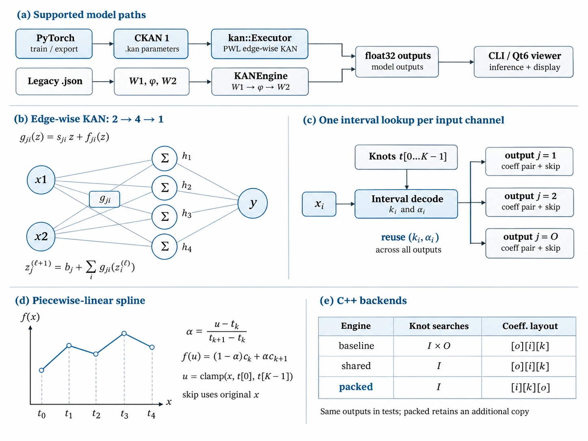

# cKAN — Two explicit KAN model families, verified C++ inference and memory-aware spline execution

**C++17 | original legacy JSON preserved | piecewise-linear edge-KAN CPU engine | PyTorch export and parity | CPU benchmarks | optional Qt6 GUI**

This repository supports two **distinct** numerical model families: the original
`W2 · φ(W1x)` architecture loaded from JSON, and a piecewise-linear edge-wise KAN
loaded from `CKAN 1` files. The CUDA placeholder is retained for historical
traceability but is excluded from the build. This is a verified **CPU inference**
project, not a GPU/FPGA/compute-in-memory implementation.



*Figure: The `.kan` edge-wise network, local piecewise-linear spline, per-input
interval reuse, and CPU evaluation backends. The separate legacy `.json` path is
shown for comparison. Diagram is schematic; outputs and timings are not to scale.*

## Architecture: two different families

| Family | Container | Math | Engine |
|---|---|---|---|
| Legacy original | `*.json` | `x_{l+1}=W2_l phi_l(W1_l x_l)` | `KANEngine` |
| Edge-wise PWL | `CKAN 1` (`*.kan`) | `y_o=b_o+sum_i[skip_{oi} x_i + spline_{oi}(x_i)]` | `kan::Executor` |

**DO NOT convert legacy JSON weights to CKAN1 by renaming fields**. An inner spline applied
to a mixture of input features is generally not a sum of univariate functions of each feature.
Both families are mathematically validated; the old legacy engine previously evaluated only
`layers[0]` and the update fixes multilayer chaining.

### Edge-wise numerical contract

For sorted layer-specific knots `t_0<...<t_{K-1}`, clamp the *spline argument* to the knot
range; do not clamp the skip input. For interval `k` with `t_k<=clip(x)<=t_{k+1}` set
`alpha=(clip(x)-t_k)/(t_{k+1}-t_k)` and evaluate
`(1-alpha)c[o,i,k]+alpha*c[o,i,k+1]`. Stored coefficients and inputs are float32;
edge contributions use double accumulation with fixed input-index order; output casts to
float32 between layers. The three backends below are bitwise identical on the tested cases.

| Backend | Decode | Storage |
|---|---|---|
| `baseline` | Per input/output edge (`I*O` binary searches) | `[output][input][knot]` |
| `shared` | Per input (`I` searches) | `[output][input][knot]` |
| `packed` | Per input (`I` searches) | Additional `[input][knot][output]` |

`packed` incurs a one-time coefficient transposition and an extra parameter copy. It is not
GPU acceleration, CIM, or a speed guarantee independent of model geometry.

### Legacy numerical contract

A legacy layer has `W1: hidden x input`, `phi: hidden` independent piecewise-linear splines,
and `W2: output x hidden`. Its `float32` arithmetic and boundary clamp retain the intended
original semantics. Strict model validation now rejects inconsistent matrix sizes,
unordered/invalid knots, nonfinite values, and disconnected layers. Original `dummy_model.json`
on input `(0.4,-0.2)` yields approximately `0.505`.

## Build and run in WSL

```bash
sudo apt update
sudo apt install -y build-essential cmake libboost-dev python3-venv
cmake -S . -B build -DCMAKE_BUILD_TYPE=Release
cmake --build build -j2
ctest --test-dir build --output-on-failure

# New edge-KAN (3 execution strategies, 1.0 output for reference model)
./build/kan_infer --model models/example.kan --input 0.4,-0.2 --engine packed
# Original model, mathematically distinct (approx. 0.505)
./build/kan_legacy_infer --model models/dummy_model.json --input 0.4,-0.2
```

Boost.PropertyTree is header-only here and is used only for the legacy JSON loader.
If Boost headers are not installed, the core and `kan_legacy` arithmetic tests still build,
but `.json` loading is disabled. Install `libboost-dev` for the legacy JSON CLI and GUI.

For the GUI, install Qt6 development headers and select the optional target:

```bash
sudo apt install -y qt6-base-dev
cmake -S . -B build/gui -DCMAKE_BUILD_TYPE=Release -DKAN_BUILD_GUI=ON
cmake --build build/gui -j2
./build/gui/KANViewer
```

The GUI uses **the original `src/main.cpp` and `src/gui/MainWindow.*` source paths**.
Load `.kan` to select baseline/shared/packed. Load `.json` to use the legacy backend;
backend selection is disabled because those optimizations do not apply to that representation.
The GUI has a conservative 64-feature input limit; use CLI for larger models. Qt6 compilation
and live GUI behavior remain to be verified on a Qt6-equipped machine.

## Model training, exactness, and benchmarks

```bash
python3 -m venv .venv
source .venv/bin/activate
python -m pip install -r requirements.txt
make check           # trains 2->4->1 PWL KAN + matched MLP; 256-sample C++ parity
make benchmark       # raw host measurements in results/bench_host.csv
make trained-bench   # small trained model, multiple batch sizes
make plot            # charts derived from CSV
make sanitized       # ASan + UBSan
```

Training example: `y=sin(pi*x0)+0.4*x1^2-0.2*x0*x1`, uniform knots; it does not implement
nonuniform PyTorch training, original cubic B-splines, or external PyKAN checkpoint loading.
Previous `results/` data comes from the **prepared PerformanceEngine experiment** and is not
measured on the user's WSL host. Always rerun benchmarks on your target machine and retain
host/CPU/compiler metadata. The matched-parameter tanh MLP performs better on this small
task; see `results/trained/metrics.json` and the accompanying numerical report.

## Local verification (WSL, 2026-11-06)

On the integration worktree, the user reported a successful Release build and
**6/6 sanitizer-enabled CTest checks**, independent PyTorch/C++ parity on 256
held-out samples (maximum absolute error **4.36 × 10⁻⁷**), and regenerated CPU
benchmark CSV and plots. The measured latency is machine- and shape-dependent;
consult `results/bench_host.csv` rather than interpreting any single speedup as
universal. The Qt6 GUI has **not yet been confirmed running** on that WSL host.

## Project map

```
include/kan/model.hpp         Edge-wise model and CPU executor API
src/model.cpp                Edge-wise baseline/shared/packed implementation
src/cli_main.cpp             Native .kan inference CLI
src/inference/kan_engine.*   Corrected original W2*phi(W1*x) engine
models/model_loader.*        Validated original JSON model loader
src/legacy_main.cpp          Original JSON model inference CLI
src/main.cpp                 Original Qt entrypoint, preserved
src/gui/MainWindow.*        Updated dual-model GUI
src/inference/kan_cuda.*    Original SQUARE-input CUDA placeholder; NOT BUILT
models/dummy_model.json     Original JSON fixture
models/*.kan                 CKAN1 fixtures and trained model
src/CMakeLists.txt          Historical path; root CMake enumerates targets
.github/workflows/ci.yml    CPU, numerical parity, sanitizer, optional GUI build
scripts/                     Safe worktree integration script
```

## Claims and limitations

- Verified here: CPU compilation, CTest, original JSON fixture parity, baseline/shared/packed
  exact equivalence, sanitizer and independent PyTorch parity when rerun.
- Not verified here: Qt6 GUI compilation, physical GPU, FPGA or ASIC, power/energy measurements.
- The original `.cu` squares an input; it is intentionally disabled and must not be described
  as a genuine CUDA KAN implementation.
- Previous README claims of ONNX Runtime, PyKAN interoperability, and GPU acceleration were
  aspirations unsupported by the original checked-in source; they are not implemented here.
- Shared interval decoding is an engineering optimization, not a demonstrated novel algorithm.

See `docs/INTEGRATION.md`, `docs/numerical_contract.md` and `docs/benchmark_methodology.md`.
